<picture>
  <source media="(prefers-color-scheme: dark)" srcset="assets/hero-dark.svg">
  <source media="(prefers-color-scheme: light)" srcset="assets/hero-light.svg">
  
</picture>

&nbsp;

Most agent demos stop at *"look, it did the thing."* I care about the step after that.
My agents read the inbox, take the order, listen to the loan applicant, look at the plate.
They do the boring part fast. Then they **stop at one line they are not allowed to cross on their own**:
sending, paying, approving, logging. That line is drawn in amber on every card below.

&nbsp;

### `fleet`

<a href="https://github.com/krushna-sahu1/unified-inbox"><picture><source media="(prefers-color-scheme: dark)" srcset="assets/fleet-01-dark.svg"><source media="(prefers-color-scheme: light)" srcset="assets/fleet-01-light.svg"></picture></a>
<a href="https://agentic-dish.vercel.app"><picture><source media="(prefers-color-scheme: dark)" srcset="assets/fleet-02-dark.svg"><source media="(prefers-color-scheme: light)" srcset="assets/fleet-02-light.svg"></picture></a>
<a href="https://lensbite-seven.vercel.app"><picture><source media="(prefers-color-scheme: dark)" srcset="assets/fleet-03-dark.svg"><source media="(prefers-color-scheme: light)" srcset="assets/fleet-03-light.svg"></picture></a>
<a href="https://github.com/krushna-sahu1/jarvix"><picture><source media="(prefers-color-scheme: dark)" srcset="assets/fleet-04-dark.svg"><source media="(prefers-color-scheme: light)" srcset="assets/fleet-04-light.svg"></picture></a>
<a href="https://github.com/krushna-sahu1/Loan_Agent"><picture><source media="(prefers-color-scheme: dark)" srcset="assets/fleet-05-dark.svg"><source media="(prefers-color-scheme: light)" srcset="assets/fleet-05-light.svg"></picture></a>
<a href="https://patholab-connects.vercel.app"><picture><source media="(prefers-color-scheme: dark)" srcset="assets/fleet-06-dark.svg"><source media="(prefers-color-scheme: light)" srcset="assets/fleet-06-light.svg"></picture></a>

<b>also shipped</b> &nbsp;5 smaller builds

&nbsp;

| | |
|---|---|
| [**Edstep AI Interview Coach**](https://edstep-ai-interview-coach.vercel.app) | An AI coach for interview practice. Live on Vercel. |
| [**MailSeen**](https://github.com/krushna-sahu1/MailSeen) | Self-hosted email open tracking, plus a Gmail extension (Manifest V3). No third parties. |
| [**mail-mind-bot**](https://github.com/krushna-sahu1/mail-mind-bot) | Local AI that reads and sorts your Gmail, controlled from Telegram. |
| [**rag-doc-chat**](https://github.com/krushna-sahu1/rag-doc-chat) | Chat with your PDFs on a fully local model. No internet, no keys. |
| [**shopmind**](https://github.com/krushna-sahu1/shopmind) | Restaurant reviews in, business answers out, over RAG and a Telegram bot. |

&nbsp;

### `stack`

<picture>
  <source media="(prefers-color-scheme: dark)" srcset="assets/stack-dark.svg">
  <source media="(prefers-color-scheme: light)" srcset="assets/stack-light.svg">
  
</picture>

&nbsp;

### `signal`

<picture>
  <source media="(prefers-color-scheme: dark)" srcset="assets/signal-dark.svg">
  <source media="(prefers-color-scheme: light)" srcset="assets/signal-light.svg">
  
</picture>

<table><tr>
<td width="50%" valign="top">

#### `now`

<!-- NOW:START -->
`19h ago`  [**lensbite**](https://github.com/krushna-sahu1/lensbite) 
`20h ago`  [**agentic_dish**](https://github.com/krushna-sahu1/agentic_dish) 
`17d ago`  [**unified-inbox**](https://github.com/krushna-sahu1/unified-inbox)

updated 27 Nov 2026, 22:13 IST by <code>scripts/build.py</code>
<!-- NOW:END -->

</td>
<td width="50%" valign="top">

#### `talk to this page`

Open an issue with a command as the title. A GitHub Action answers in under a minute.

[`/whoami`](https://github.com/krushna-sahu1/krushna-sahu1/issues/new?title=/whoami&body=Just%20hit%20submit.) &nbsp;
[`/fleet`](https://github.com/krushna-sahu1/krushna-sahu1/issues/new?title=/fleet&body=Just%20hit%20submit.) &nbsp;
[`/stack`](https://github.com/krushna-sahu1/krushna-sahu1/issues/new?title=/stack&body=Just%20hit%20submit.) &nbsp;
[`/rule`](https://github.com/krushna-sahu1/krushna-sahu1/issues/new?title=/rule&body=Just%20hit%20submit.) &nbsp;
[`/contact`](https://github.com/krushna-sahu1/krushna-sahu1/issues/new?title=/contact&body=Write%20your%20message%20here.)

<!-- LOG:START -->
no sessions yet. be the first.
<!-- LOG:END -->

</td>
</tr></table>

<!--
  You read the source. Nice.
  Everything on this page is drawn by scripts/build.py from live GitHub data, every 6 hours.
  No stats services, no badges, no third-party images.
-->
